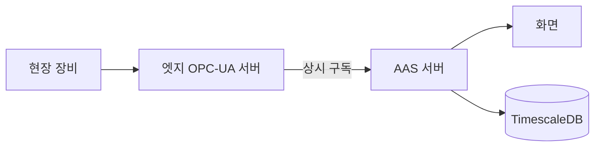
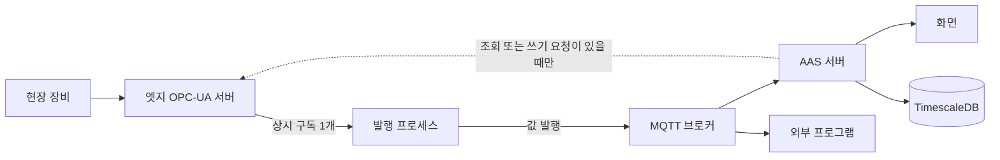
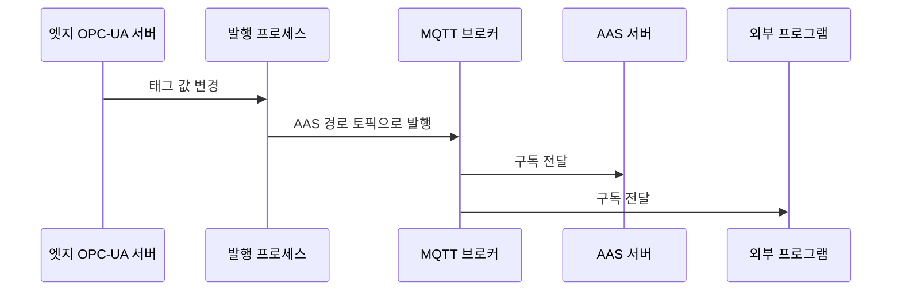

# MQTT 배포 아키텍처 제안

작성일: 2026-11-10  
대상: `camtic-aas-backend-viewer` (이하 AAS 서버)  
상태: 제안. 이 문서는 구현 지시가 아니다.

## 1. 결론

현장 데이터는 지금처럼 엣지 OPC-UA 서버 한 곳에 모은다.  
그 서버를 구독하는 OPC-UA 클라이언트는 상시로 하나만 둔다.  
그 클라이언트는 AAS 서버 밖에 두고, 받은 값을 MQTT 브로커에 올린다.  
AAS 서버와 외부 프로그램은 브로커를 구독한다.

AAS 서버가 엣지 서버로 값을 다시 보내거나, 엣지와 AAS 서버 사이에 수집용 미들웨어를 하나 더 두지 않는다.

## 2. 용어

| 이름 | 의미 |
| --- | --- |
| 엣지 OPC-UA 서버 | 현장 장비 값이 모이는 서버. 현재 주소는 `data/config/opcua/catalog.json` 의 `opc.tcp://218.158.231.215:24840` |
| AAS 서버 | 이 프로젝트. AASX 패키지를 보관하고 화면과 HTTP API를 제공한다. OPC-UA 서버가 아니다. |
| 발행 프로세스 | 새로 만들 프로그램. 엣지 서버를 구독하고 MQTT로 값을 올린다. |
| MQTT 브로커 | 메시지를 받아서 구독자에게 전달하는 서버. 발행 프로세스, AAS 서버와 따로 실행한다. |
| 상시 구독 | 프로그램이 켜져 있는 동안 태그 값 변화를 계속 받는 연결 |
| 요청 시 연결 | 사용자가 조회나 쓰기를 누를 때만 잠깐 연결했다가 끊는 연결 |

`engineering.csv` 의 Edge 역할 값은 `Collector+Parser+AASMapper+OPCUAServer` 이다. 수집, AAS 경로 매핑, OPC-UA 공개는 이미 엣지 서버의 역할이다.

## 3. 현재 구조

AAS 서버가 시작되면 카탈로그의 엣지 서버에 접속한다.  
`engineering.csv` 의 Variable NodeId를 상시 구독하고, 최신 값을 메모리에 둔다.

화면의 실시간 그래프는 `GET /api/opcua/packages/{package_id}/live` 와 SSE `/live/stream` 으로 이 메모리를 읽는다.  
TimescaleDB 기록이 켜져 있으면 같은 수신 콜백에서 값을 저장한다.  
조회, 쓰기, browse도 이 OPC-UA 클라이언트를 사용한다.



외부 프로그램이 같은 값을 받으려면 AAS 서버의 HTTP API를 부르거나, 엣지 서버에 OPC-UA 클라이언트를 또 붙여야 한다.  
MQTT 발행은 없다.

## 4. 제안 구조



점선은 상시 연결이 아니다. 화면의 OPC-UA 유틸리티에서 browse, read, write를 할 때만 AAS 서버가 엣지 서버에 접속한다.

한 값이 지나가는 순서는 다음과 같다.



발행 프로세스는 AAS 서버의 주소를 모른다. AAS 서버도 발행 프로세스의 주소를 모른다. 둘 다 브로커 주소만 안다.

## 5. 구성

| 구성 | 실행 위치 | 하는 일 | 프로토콜 |
| --- | --- | --- | --- |
| 엣지 OPC-UA 서버 | 기존 서버. 변경 없음 | 현장 값을 모아 OPC-UA로 제공 | OPC-UA |
| 발행 프로세스 | AAS 서버 프로세스 밖 | Variable 구독, MQTT 발행 | OPC-UA 클라이언트 1개, MQTT 발행 |
| MQTT 브로커 | 별도 프로세스 | 마지막 값 보관, 구독자에게 전달 | MQTT |
| AAS 서버 | 기존 프로세스 | 패키지, 화면, API, DB 기록, 요청 시 OPC-UA 조회·쓰기 | MQTT 구독, 요청 시 OPC-UA |
| 외부 프로그램 | 브로커에 접속하는 쪽 | 필요한 토픽만 구독 | MQTT |

발행 프로세스가 읽는 파일은 다음 두 가지이다.

- `data/config/opcua/catalog.json`: 접속 주소, 보안 정책, `nodeIdNamespace`
- 패키지별 `opcua/engineering.csv`: 구독할 NodeId, 토픽으로 쓸 `AasPath`

이 파일은 AAS 서버가 AASX를 올릴 때 만든다. 발행 프로세스는 읽기만 한다. 실행 중에는 두 프로그램이 서로 HTTP를 호출하지 않는다.

`engineering.csv` 의 NodeId와 현장 네임스페이스 번호가 다르면, 카탈로그의 `nodeIdNamespace` 로 바꿔 구독한다. 이 규칙은 현재 AAS 서버의 구독 규칙과 같다.

### 5.1 메시지

토픽은 `AasPath` 를 그대로 쓴다. 예:

`aas/Hyundai_HH7_AAS_Template_v0.3/HH7/RobotKinematicState/JointPosition/J1`

메시지는 JSON이며, 브로커가 토픽마다 마지막 값을 저장한다. 나중에 접속한 구독자도 현재 값을 바로 받는다.

```json
{
  "packageId": "Hyundai_HH7_AAS_Template_v0.3",
  "path": "RobotKinematicState/JointPosition/J1",
  "nodeId": "ns=1;s=Hyundai_HH7_AAS_Template_v0.3/HH7/RobotKinematicState/JointPosition/J1",
  "value": -82.4,
  "status": "Good",
  "sourceTimestamp": "2026-11-10T04:00:00Z"
}
```

OPC-UA 구독 주기의 현재 기본값은 500ms이다. 발행은 값이 바뀔 때만 한다.

## 6. AAS 서버에서 바뀌는 점

### 6.1 추가

| 항목 | 내용 |
| --- | --- |
| MQTT 설정 | 브로커 주소, 포트, 계정, 구독할 토픽 접두어 |
| MQTT 구독 | 브로커에서 값 변경과 마지막 값을 수신 |
| 실시간 값의 출처 | 화면용 live 캐시를 MQTT 수신 값으로 채움 |
| 기록의 출처 | TimescaleDB 기록이 켜진 경우, OPC-UA 콜백 대신 MQTT 수신 값을 저장 |

화면 API의 주소는 유지한다. `GET /api/opcua/packages/{package_id}/live` 와 `/live/stream` 은 그대로 두고, 안쪽 데이터만 MQTT에서 온다.

### 6.2 제거

| 항목 | 현재 동작 | 제안 후 |
| --- | --- | --- |
| 시작 시 OPC-UA 자동 접속 | `OPCUA_AUTO_CONNECT` 로 카탈로그 서버에 접속하고 Variable 전체를 상시 구독 | 상시 구독을 하지 않음 |
| live 캐시의 입력 | `OpcUaSession` 수신 콜백이 최신 값을 기록 | MQTT 수신이 최신 값을 기록 |
| DB 기록 입력 | `OpcUaRecorder` 가 OPC-UA 콜백에 연결됨 | MQTT 수신에 연결 |
| 북향 배포 | HTTP로 이 서버에 접속해야 값을 받을 수 있음 | 외부 배포는 브로커가 담당 |

### 6.3 유지

- AASX 업로드, 목록, 트리, 다운로드, 삭제
- `nodeset.xml`, `engineering.csv`, `syscfg.json` 생성
- 화면, 카메라 프록시, 시뮬레이션
- TimescaleDB 조회 API
- OPC-UA browse, read, write, 수동 subscribe API

수동 subscribe와 시작 시 전체 구독은 분리한다. 유틸리티에서 일부 노드를 직접 구독하는 기능은 요청이 있는 동안만 동작하게 둔다. 화면의 기본 실시간 경로는 이 수동 구독을 사용하지 않는다.

## 7. 개발 예정

순서를 지키면, 발행이 확인되기 전에 AAS 서버의 기존 구독을 지우지 않아도 된다.

| 단계 | 작업 | 완료 기준 |
| --- | --- | --- |
| 1 | MQTT 브로커를 AAS 서버와 따로 실행 | 브로커가 기동하고, 테스트 구독자가 메시지를 수신 |
| 2 | 발행 프로세스 작성. 카탈로그와 `engineering.csv` 를 읽어 Variable만 구독하고 토픽으로 발행 | 엣지 값 하나가 바뀌면 해당 토픽에 JSON이 도착. 재접속 후에도 구독이 복구됨 |
| 3 | AAS 서버에 MQTT 구독 추가. live 캐시와 DB 기록을 MQTT 수신으로 갱신 | 기존 live API와 SSE 화면이 MQTT 값으로 갱신됨 |
| 4 | AAS 서버의 시작 시 상시 OPC-UA 구독 제거 | OPC-UA 상시 세션은 발행 프로세스 1개. 화면과 DB는 계속 갱신됨 |
| 5 | browse, read, write가 요청 중에만 엣지 서버에 접속하는지 확인 | 유틸리티를 쓰지 않을 때 AAS 서버에 상시 OPC-UA 세션이 없음 |

1단계와 2단계가 끝나도 현재 화면은 기존 OPC-UA 구독으로 동작할 수 있다. 4단계에서 상시 구독을 제거한다.

## 8. 확장

이번 개발에 포함하지 않고, 필요해질 때 브로커와 발행 규칙 위에서 덧붙인다.

| 항목 | 내용 |
| --- | --- |
| 외부 구독자 | 브로커 계정과 토픽 권한을 추가한다. 엣지 서버와 AAS 서버 코드는 수정하지 않는다. |
| 암호화와 로그인 | 브로커 구간은 TLS와 계정을 사용한다. 현장 OPC-UA 보안 정책은 현재 카탈로그 값을 유지한다. |
| 패키지 추가 | AASX 업로드로 `engineering.csv` 가 생기면 발행 프로세스가 해당 Variable을 구독 목록에 넣는다. |
| 기록 위치 | DB 저장을 AAS 서버에 둘지, 발행 프로세스 다음의 별도 저장 프로그램으로 옮길지는 기록 요건이 정해진 뒤 정한다. |
| 현장 쓰기 | MQTT로 명령을 받아 OPC-UA write로 내리는 경로는 만들지 않는다. 쓰기는 현재처럼 AAS 서버 유틸리티의 요청 시 연결로 제한한다. |
| 다른 메시지 형식 | Sparkplug B처럼 정해진 산업용 형식이 필요해지면, 발행 JSON을 그 형식으로 바꾸는 작업을 따로 둔다. |

## 9. 장애 시 동작

| 상황 | 결과 |
| --- | --- |
| AAS 서버 재시작 | 발행과 외부 구독은 계속된다. 화면은 브로커에 남아 있는 마지막 값으로 다시 채워진다. |
| 발행 프로세스 재시작 | 그 사이 변경 값은 전달되지 않는다. 재접속 후 엣지 서버가 현재 값을 보내면 브로커의 마지막 값이 갱신된다. |
| 브로커 중단 | 화면과 외부 구독이 함께 멈춘다. 엣지 서버의 원본 값은 유지된다. |
| 엣지 서버 중단 | 새 값이 없다. 브로커에는 중단 전의 마지막 값이 남는다. |
